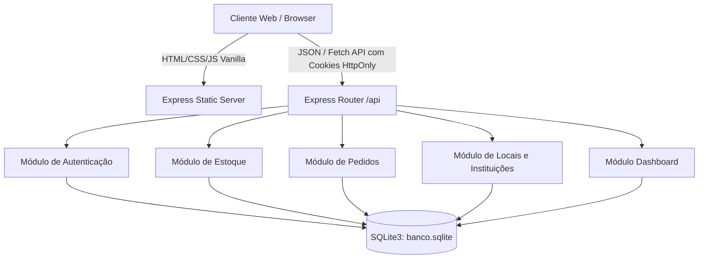

# FAP Solidário — Plataforma Integrada de Gestão e Conexão de Doações

[](https://nodejs.org/)
[](https://expressjs.com/)
[](https://www.sqlite.org/)
[](LICENSE)

O **FAP Solidário** é uma plataforma web completa desenvolvida no âmbito acadêmico pelo **IFMT (Instituto Federal de Mato Grosso — Campus Barra do Garças)** para articular, centralizar e simplificar a gestão de doações de mantimentos, vestuário, itens de higiene, móveis e auxílio financeiro para entidades beneficentes e comunidades em situação de vulnerabilidade em Barra do Garças e região.

---

## Índice

1. [Visão Geral do Projeto (Executive Summary)](#1-visão-geral-do-projeto-executive-summary)
2. [Perfis de Usuário e Regras de Negócio](#2-perfis-de-usuário-e-regras-de-negócio)
3. [Requisitos do Sistema (Usuário, Funcionais e Não Funcionais)](#3-requisitos-do-sistema)
4. [Arquitetura do Sistema e Stack Tecnológica](#4-arquitetura-do-sistema-e-stack-tecnológica)
5. [Manual de Instalação e Execução (Getting Started)](#5-manual-de-instalação-e-execução-getting-started)
6. [Documentação de Endpoints da API (API Reference)](#6-documentação-de-endpoints-da-api-api-reference)
7. [Funcionalidades e Experiência do Utilizador (UI/UX)](#7-funcionalidades-e-experiência-do-utilizador-uiux)
8. [Guia de Contribuição e Testes Automatizados](#8-guia-de-contribuição-e-testes-automatizados)

---

## 1. Visão Geral do Projeto (Executive Summary)

### 1.1 Objetivo Principal
Conectar de forma ágil, segura e auditável pessoas físicas e jurídicas (doadores) a instituições socioassistenciais locais (APAE, Vicentinos, Centro Espírita Paulo de Tarso, Associação dos Cegos, Obras Sociais Francisco de Assis, etc.). A solução disponibiliza transparência através de controle de estoque em tempo real, pedidos monitorados, dashboards estatísticos e canais interativos diretos (WhatsApp e chamada telefônica nativa).

### 1.2 Público-Alvo
* **Doadores (Pessoa Física):** Cidadãos interessados em doar alimentos não perecíveis, agasalhos, móveis, utilidades ou valores financeiros.
* **Empresas e Organizações:** Parceiros corporativos que realizam destinação de excedentes comerciais ou doações periódicas em lote, com presença destacada no ranking analítico.
* **Beneficiários e ONGs:** Instituições cadastradas e comunidades assistidas que consultam itens disponíveis em estoque e requisitam doações de acordo com suas demandas emergenciais.
* **Administradores e Operadores:** Gestores responsáveis pela triagem, validação das instituições e supervisão dos fluxos de saída.

---

## 2. Perfis de Usuário e Regras de Negócio

### 2.1 Perfis de Usuário (Roles & Permissions)

| Tipo de Conta | Papel no Sistema (`papel`) | Destino Pós-Login | Permissões e Acessos |
|---|---|---|---|
| **Doador Comum** | `doador` | `/pages/opcoes.html` | Cadastrar itens em estoque (`POST /api/estoque`), consultar dashboard, visualizar locais parceiros, consultar informações. **Restrição:** não pode solicitar pedidos. |
| **Empresa** | `doador` | `/pages/opcoes.html` | Cadastrar lotes de doações, figurar no ranking público do dashboard institucional, sincronização automática como ponto parceiro em `/api/locais`. |
| **Beneficiário** | `recebedor` | `/pages/receber.html` | Navegar pelo catálogo dividido por abas temáticas, emitir pedidos de recebimento (`POST /api/pedidos`), visualizar histórico "Meus Pedidos". **Restrição:** bloqueado para inserção no estoque. |

### 2.2 Regras de Negócio (Business Rules)

* **[RN01] Validação de Perfil para Estoque:** Apenas contas autenticadas com papel `doador` podem registrar itens na tabela de estoque.
* **[RN02] Exclusividade de Pedidos:** Apenas usuários com papel `recebedor` (Beneficiários) podem gerar pedidos de doação.
* **[RN03] Baixa Automática e Integridade de Estoque:** A aprovação ou criação de um pedido reserva/deduz imediatamente a quantidade disponível no item do estoque. A quantidade nunca pode ser negativa (`quantidade >= 0`).
* **[RN04] Validação de Validade de Perecíveis:** Alimentos e itens perecíveis exigem data de validade em conformidade com o formato ISO (`AAAA-MM-DD`).
* **[RN05] Segurança de Credenciais:** Senhas são gravadas obrigatoriamente sob hash criptográfico irreversível (utilizando algoritmo seguro `scrypt` com sal e parâmetros de custo de memória).
* **[RN06] Isolamento de Sessão:** A sessão é armazenada via cookie seguro assinado `HttpOnly` com tempo de vida de 8 horas, prevenindo roubo de credenciais via XSS.
* **[RN07] Sincronização em Tempo Real de Empresas:** Quando uma nova organização se cadastra como `Empresa` ou `Beneficiário`, um registro correspondente de ponto de coleta é propagado na tabela `locais`, disponibilizando o novo parceiro dinamicamente nas listagens com mapa embutido.

---

## 3. Requisitos do Sistema

### 3.1 Requisitos de Usuário (RU)
* **RU01:** O usuário deve conseguir se cadastrar escolhendo claramente sua intenção (Doador Comum, Empresa ou Beneficiário).
* **RU02:** O usuário deve navegar por categorias de doação bem delimitadas (Roupas, Alimentos, Higiene, Móveis, Cultura e Dinheiro).
* **RU03:** O doador deve poder consultar o endereço, o telefone, a rota no mapa e abrir o WhatsApp com mensagem pré-configurada da instituição receptora.
* **RU04:** O usuário deve ser capaz de filtrar instantaneamente instituições e bairros digitando em uma barra de pesquisa.
* **RU05:** O usuário deve poder copiar com um clique o endereço completo do local para colar no GPS/Waze.
* **RU06:** O beneficiário deve conseguir solicitar quantidades específicas de mantimentos disponíveis.

### 3.2 Requisitos Funcionais (RF)
* **RF01 (Autenticação):** Prover cadastro, login com emissão de cookie de sessão assinado e logout com invalidação.
* **RF02 (Gestão de Estoque):** Permitir inclusão, listagem, validação de itens com doador_id e suporte a estoque zerado.
* **RF03 (Gestão de Pedidos):** Permitir requisição de itens por recebedores, associação ao estoque e acompanhamento de status (`pendente`, `concluido`, `cancelado`).
* **RF04 (Dashboard Analítico):** Consolidar totais de doações ativas, volume de pedidos, distribuição percentual por categoria e ranking de empresas doadoras.
* **RF05 (Módulo de Locais Dinâmico):** Expor endpoint `GET /api/locais` com suporte ao parâmetro `?categoria=` e injeção assíncrona no DOM.
* **RF06 (Interatividade de Contato):** Gerar URLs nativas `tel:55...` e redirecionamento de mensageria `https://wa.me/55...`.
* **RF07 (Proteção de Rotas Frontend):** Guardião client-side em `api.js` que verifica a sessão do usuário e redireciona papéis não autorizados.

### 3.3 Requisitos Não Funcionais (RNF)
* **RNF01 (Desempenho):** A API em Node.js com SQLite em modo WAL (Write-Ahead Logging) deve responder a consultas de listagem em menos de 100ms em ambiente de homologação.
* **RNF02 (Responsividade):** Interface frontend construída sob CSS Grid e Flexbox fluido, adaptando-se perfeitamente a resoluções de desktop (1920px a 1080px), tablets (768px a 1024px) e smartphones (320px a 680px).
* **RNF03 (Segurança):** Cookies com atributos `HttpOnly`, proteção contra SQL Injection com queries 100% parametrizadas (Prepared Statements) e sanitização de dados no frontend contra ataques XSS.
* **RNF04 (Disponibilidade e Portabilidade):** Operação autônoma sem dependências de serviços de nuvem externos pesados para o banco de dados primário (arquivo SQLite local gerenciado).

---

## 4. Arquitetura do Sistema e Stack Tecnológica



### 4.1 Tecnologias Empregadas
* **Backend Runtime:** Node.js (v20+ LTS / v24).
* **Framework Web:** Express.js (v5.x), com middlewares de `cookie-parser`, `cors` e `dotenv`.
* **Persistência de Dados:** SQLite3 com driver nativo compilado, operando com `PRAGMA foreign_keys = ON` e `PRAGMA journal_mode = WAL`.
* **Frontend:** HTML5 Semântico, CSS3 Moderno (Custom Properties, Flexbox e CSS Grid fluido) e JavaScript Vanilla assíncrono modular (ES6+).
* **Segurança de Senhas:** `node:crypto` (`scrypt` + sal randômico de 16 bytes).

### 4.2 Modelo de Dados Relacional (Schema)

```sql
-- Usuários (Doadores, Empresas e Beneficiários)
CREATE TABLE usuarios (
    id         INTEGER PRIMARY KEY AUTOINCREMENT,
    nome       TEXT    NOT NULL,
    email      TEXT    NOT NULL UNIQUE,
    senha_hash TEXT    NOT NULL,
    papel      TEXT    NOT NULL DEFAULT 'doador' CHECK (papel IN ('doador', 'recebedor')),
    tipo       TEXT    NOT NULL DEFAULT 'Doador Comum' CHECK (tipo IN ('Doador Comum', 'Empresa', 'Beneficiário')),
    criado_em  TEXT    NOT NULL DEFAULT (datetime('now', 'localtime'))
);

-- Estoque Central de Doações
CREATE TABLE estoque (
    id            INTEGER PRIMARY KEY AUTOINCREMENT,
    doador_id     INTEGER REFERENCES usuarios (id) ON DELETE SET NULL,
    nome_item     TEXT    NOT NULL,
    categoria     TEXT    NOT NULL CHECK (categoria IN ('Alimentos', 'Roupas', 'Higiene', 'Moveis', 'Cultura', 'Dinheiro', 'Outros')),
    quantidade    INTEGER NOT NULL CHECK (quantidade >= 0),
    empresa_nome  TEXT    NOT NULL,
    data_validade TEXT,
    criado_em     TEXT    NOT NULL DEFAULT (datetime('now', 'localtime'))
);

-- Solicitações e Pedidos dos Beneficiários
CREATE TABLE pedidos (
    id           INTEGER PRIMARY KEY AUTOINCREMENT,
    estoque_id   INTEGER NOT NULL REFERENCES estoque (id),
    recebedor_id INTEGER NOT NULL REFERENCES usuarios (id),
    quantidade   INTEGER NOT NULL CHECK (quantidade > 0),
    status       TEXT    NOT NULL DEFAULT 'pendente' CHECK (status IN ('pendente', 'concluido', 'cancelado')),
    criado_em    TEXT    NOT NULL DEFAULT (datetime('now', 'localtime'))
);

-- Locais de Coleta e Entidades Assistenciais
CREATE TABLE locais (
    id         INTEGER PRIMARY KEY AUTOINCREMENT,
    usuario_id INTEGER REFERENCES usuarios (id) ON DELETE SET NULL,
    nome       TEXT    NOT NULL,
    telefone   TEXT    NOT NULL DEFAULT '',
    endereco   TEXT    NOT NULL DEFAULT 'Barra do Garças - MT',
    categorias TEXT    NOT NULL DEFAULT 'todas',
    mapa_url   TEXT    DEFAULT '',
    tipo       TEXT    NOT NULL DEFAULT 'Ponto de Coleta',
    criado_em  TEXT    NOT NULL DEFAULT (datetime('now', 'localtime'))
);
```

---

## 5. Manual de Instalação e Execução (Getting Started)

### 5.1 Pré-requisitos
* **Node.js:** Versão 20.0.0 ou superior instalada ([Download Node.js](https://nodejs.org/)).
* **Gerenciador de Pacotes:** `npm` (incluso no instalador do Node).
* **Terminal:** PowerShell, Bash ou Prompt de Comando.

### 5.2 Passo a Passo de Inicialização

1. **Clonar o Repositório:**
   ```bash
   git clone https://github.com/Fernandofut/fapsolidario.git
   cd fapsolidario
   ```

2. **Instalar Dependências da API:**
   ```bash
   cd api
   npm install
   ```

3. **Configuração de Variáveis de Ambiente:**
   Copie o arquivo de exemplo `.env.example` para `.env` na pasta `api/`:
   ```bash
   cp .env.example .env
   ```
   *Conteúdo do arquivo `api/.env`:*
   ```env
   PORT=3000
   SESSION_SECRET=coloque-um-segredo-longo-e-aleatorio-aqui
   # CORS_ORIGIN=http://localhost:5500 (Opcional, em dev aceita qualquer origem)
   ```

4. **Executar o Servidor:**
   * Modo produção:
     ```bash
     npm start
     ```
   * Modo desenvolvimento com reinicialização automática (`watch`):
     ```bash
     npm run dev
     ```

5. **Acesso à Aplicação:**
   Abra o navegador e acesse:
   ```text
   http://localhost:3000
   ```
   *O backend Express atua como servidor estático unificado, disponibilizando diretamente a interface do usuário.*

---

## 6. Documentação de Endpoints da API (API Reference)

### 6.1 Autenticação e Sessão (`/api/auth`)

#### `POST /api/auth/cadastro`
Registra novo usuário no sistema. Se for `Empresa` ou `Beneficiário`, cria automaticamente o ponto em `/api/locais`.
* **Body:**
  ```json
  {
    "nome": "Supermercado Pantanal",
    "email": "contato@pantanal.com",
    "senha": "senhaSegura123",
    "tipo": "Empresa",
    "telefone": "(66) 99888-1234"
  }
  ```
* **Resposta (201 Created):**
  ```json
  {
    "mensagem": "Conta criada com sucesso! Faça login para continuar.",
    "usuario": {
      "id": 4,
      "nome": "Supermercado Pantanal",
      "email": "contato@pantanal.com",
      "papel": "doador",
      "tipo": "Empresa"
    }
  }
  ```

#### `POST /api/auth/login`
Autentica o usuário e grava o cookie assinado de sessão.
* **Body:**
  ```json
  {
    "email": "teste@fap.com",
    "senha": "123456"
  }
  ```
* **Resposta (200 OK):**
  ```json
  {
    "mensagem": "Login realizado com sucesso!",
    "id": 1,
    "nome": "Doador de Teste",
    "papel": "doador",
    "tipo": "Doador Comum"
  }
  ```

#### `GET /api/auth/sessao`
Retorna dados públicos do usuário logado (baseado no cookie).
* **Resposta (200 OK):**
  ```json
  {
    "id": 1,
    "nome": "Doador de Teste",
    "email": "teste@fap.com",
    "papel": "doador",
    "tipo": "Doador Comum"
  }
  ```

---

### 6.2 Gestão de Locais e Instituições (`/api/locais`)

#### `GET /api/locais`
Retorna pontos de doação e instituições cadastradas.
* **Parâmetros de Query:** `categoria` (opcional: `roupas`, `alimentos`, `higiene`, `moveis`, `cultura`, `dinheiro`).
* **Exemplo de Chamada:** `GET /api/locais?categoria=roupas`
* **Resposta (200 OK):**
  ```json
  [
    {
      "id": 1,
      "nome": "Centro Espírita Paulo de Tarso",
      "telefone": "(66) 99978-0094",
      "endereco": "Rua Cuiabá, Barra do Garças - MT",
      "categorias": "roupas,alimentos,dinheiro",
      "mapa_url": "https://www.google.com/maps/embed?pb=...",
      "tipo": "Ponto de Coleta",
      "criado_em": "2026-10-29 10:00:00"
    }
  ]
  ```

#### `POST /api/locais`
Cadastra manualmente um novo ponto institucional.
* **Body:**
  ```json
  {
    "nome": "Nova Entidade Solidária",
    "telefone": "(66) 99999-1122",
    "endereco": "Av. Central, Barra do Garças - MT",
    "categorias": "alimentos,higiene",
    "tipo": "Instituição Beneficente"
  }
  ```
* **Resposta (201 Created):** Objeto do local criado no banco.

---

### 6.3 Gestão de Estoque (`/api/estoque`)

#### `GET /api/estoque`
Lista completa dos itens disponíveis no inventário de doações (do mais recente para o mais antigo).
* **Resposta (200 OK):**
  ```json
  [
    {
      "id": 12,
      "nome_item": "Arroz Tipo 1 - 5kg",
      "categoria": "Alimentos",
      "quantidade": 40,
      "empresa_nome": "Doador Solidário",
      "data_validade": "2026-12-31",
      "criado_em": "2026-10-29 08:30:00"
    }
  ]
  ```

#### `POST /api/estoque`
Adiciona novo item ao estoque de doações (Requer sessão ativa de `doador`).
* **Body:**
  ```json
  {
    "nome_item": "Fardo de Leite Integral 12L",
    "categoria": "Alimentos",
    "quantidade": 15,
    "empresa_nome": "Laticínios Vale",
    "data_validade": "2027-02-15"
  }
  ```

---

### 6.4 Gestão de Pedidos e Solicitações (`/api/pedidos`)

#### `GET /api/pedidos`
Retorna a lista de pedidos solicitados pelo beneficiário logado.
* **Resposta (200 OK):**
  ```json
  [
    {
      "id": 3,
      "estoque_id": 12,
      "item": "Arroz Tipo 1 - 5kg",
      "categoria": "Alimentos",
      "quantidade": 2,
      "status": "pendente",
      "data": "2026-10-29"
    }
  ]
  ```

#### `POST /api/pedidos`
Emite solicitação de itens para um beneficiário (Requer sessão com papel `recebedor`).
* **Body:**
  ```json
  {
    "estoque_id": 12,
    "quantidade": 2
  }
  ```

---

### 6.5 Dashboard Analítico (`/api/dashboard`)

#### `GET /api/dashboard`
Consolida métricas e rankings para geração de relatórios e gráficos.
* **Resposta (200 OK):**
  ```json
  {
    "totais": {
      "doacoes": 250,
      "pedidos": 85,
      "beneficiarios": 32
    },
    "categorias": [
      { "categoria": "Alimentos", "total": 120 },
      { "categoria": "Roupas", "total": 65 }
    ],
    "ranking": [
      { "empresa": "Supermercado Pantanal", "quantidade": 80 }
    ]
  }
  ```

---

## 7. Funcionalidades e Experiência do Utilizador (UI/UX)

1. **Design System & Grid Responsivo:**
   * Unificação visual sob `frontend/assets/css/listing.css`.
   * Grelha flexível com auto-fit e breakpoints dedicados (Desktop: 3 colunas, Tablet: 2 colunas, Mobile: 1 coluna vertical).
   * Paleta institucional rigorosa: Azul Principal (`#1389ac`), Amarelo Destaque (`#f1db0c`) e Verde Ação (`#5bbd5e`).

2. **Ações Interativas de Contato:**
   * **Discagem Nativa (`tel:`):** Hiperligações telefônicas padronizadas com prefixo internacional brasileiro (`55`), permitindo discagem direta no telemóvel com 1 toque.
   * **Integração com WhatsApp (`wa.me`):** Botão dedicado com ícone oficial SVG que abre a conversa já com mensagem pré-formatada citando o nome da instituição pretendida.

3. **Usabilidade Avançada (Acessibilidade e Geolocalização):**
   * **Botão "Copiar Morada":** Ícone rápido nos cards que envia o endereço do local diretamente para a área de transferência do sistema, fornecendo feedback tátil e visual instantâneo (*"Copiada! ✓"*).
   * **Barra de Pesquisa em Tempo Real:** Filtro rápido no topo das listagens que busca por nome, endereço ou bairro em tempo real à medida que o usuário digita, com tratamento de acentuação e suporte multi-seções.

---

## 8. Guia de Contribuição e Testes Automatizados

### 8.1 Contas de Teste Pré-Configuradas

Ao iniciar o banco pela primeira vez, duas contas de demonstração são injetadas automaticamente:

| Perfil | E-mail | Senha | Função no Sistema |
|---|---|---|---|
| **Doador de Teste** | `teste@fap.com` | `123456` | Acesso ao menu do doador, cadastro de estoque e visualização de dashboards. |
| **Recebedor de Teste** | `recebedor@fap.com` | `123456` | Acesso ao catálogo de solicitações e emissão de pedidos. |

### 8.2 Execução de Testes Automatizados
O projeto utiliza o executor nativo do Node.js (`node:test`). Os testes sobem instâncias do servidor em portas dinâmicas e isolam as tabelas em bancos temporários na pasta temporária do sistema operacional, sem poluir a base de produção:

```bash
cd api
npm test
```

Para executar testes unitários e de integração específicos:
```bash
node --test tests/locais.test.js
node --test tests/dashboard.test.js
```

### 8.3 Padrões de Código e Diretrizes
* **Consultas SQL:** Nunca realize concatenação direta de variáveis em strings SQL. Utilize sempre parâmetros posicionais `?` para garantir proteção contra SQL Injection.
* **Controle de Sessão:** Toda nova página restrita deve carregar obrigatoriamente `/assets/js/api.js` para herdar as proteções automáticas de rota.
* **Frontend:** Prefira JavaScript Vanilla limpo e sem dependências externas desnecessárias, assegurando máxima velocidade de carregamento e compatibilidade entre navegadores.
